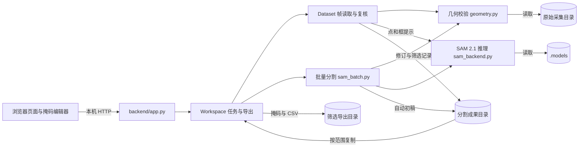

# 项目架构

更新于 2026-11-27（北京时间）。

工作台由本机 Python HTTP 服务和浏览器页面组成。根目录的 `app.py` 是启动入口，Mac 与 Windows 的双击启动器都调用它。Python 服务监听 `127.0.0.1`，从 `frontend/` 提供页面与静态文件，并处理浏览器发来的任务、预览、复核和导出请求。

## 代码放在哪里

| 路径 | 职责 |
| --- | --- |
| `app.py`、`启动SAM分割.command`、`启动SAM分割.bat` | 工作台入口。`启动分割.command` 仍可用于 Mac 双击启动 |
| `frontend/index.html` | 页面与对话框结构 |
| `frontend/styles.css` | 页面布局、尺寸和样式 |
| `frontend/editor.js` | 画布、掩码编辑、SAM 提示、单帧显示和确认保存 |
| `frontend/workflow.js` | 目录选择、批处理进度、筛选、失败记录和成果导出 |
| `backend/app.py` | 提供页面、前端资源和 `/api/` 接口 |
| `backend/workspace.py` | 管理当前成果、后台分割、导出、CSV 和上次选择的路径 |
| `backend/dataset.py` | 读取单帧和预览、保存掩码与修订、处理复核和失败状态 |
| `backend/core.py` | 发现采集、读图、计算 GrabCut 候选、统计和持久化 |
| `backend/geometry.py` | 读取实际相机标定、校正 RGB、验证掩码网格并支持点云反投影 |
| `backend/sam_batch.py`、`backend/sam_backend.py` | 为批量分割生成模型提示、运行 SAM、保存初稿和推理记录 |
| `backend/records.py`、`backend/native_picker.py` | 识别相机类型与汇总失败记录，以及 macOS 文件夹选择 |
| `backend/paths.py` | 定义项目根目录、前端、配置、模型和状态目录的路径 |
| `scripts/`、`config/` | 模型准备与传统批处理工具，以及依赖和模型来源清单 |
| `tests/unit/`、`tests/browser/`、`tests/fixtures/` | Python 测试、端到端浏览器测试，以及可复用的标定样例和 SAM 测试替身 |

## 分割、复核和导出的数据流

1. 工作台扫描原始采集目录，按所选输入查找图片和标定文件，再将采集清单写入成果目录的 `dataset.json`。批任务用 `batch_job.json` 记录进度与结果。
2. 红外模式沿用原始深度像素网格。RGB 模式读取 `reconstruction.json`，把彩色图重映射到已保存的对齐深度网格。掩码与这一帧使用同一套坐标，几何来源写入 `geometry.json`。
3. SAM 批处理用临时候选区域生成点或框提示，生成 `trunk_mask_draft.png` 和预览。编辑器也可向模型提交人工点和框，预览满意后再保存。
4. 单帧 `segmentation.json` 保存头侧、备注、筛选决定、掩码状态和修订编号。确认合格的掩码写入 `trunk_mask.png`，已保存的各次掩码修订保存在 `revisions/`。筛选决定和掩码确认各自记录。
5. 失败帧的原因保存在 `segmentation_failures.json`，旧成果也能从已有任务和汇总文件恢复这部分记录。模型推理失败时可补做分割，坐标校验失败时可查看原图并登记复核意见。
6. 导出任务按筛选范围复制现有成果，同时附上全批次失败清单、头侧方向和筛选 CSV。导出的成果清单继续引用原始采集目录。

## 接口与本机文件

| 入口 | 用途 |
| --- | --- |
| `GET /api/captures`、`GET /api/job` | 加载当前成果清单与后台任务状态 |
| `POST /api/scan`、`POST /api/batch/start`、`POST /api/batch/stop` | 扫描采集、开始和停止批处理 |
| `GET /api/frame`、`GET /api/image` | 获取单帧元数据及预览 |
| `POST /api/sam_predict`、`POST /api/save`、`POST /api/decide` | 模型预览、掩码保存和筛选记录 |
| `POST /api/open_results`、`GET /api/review.csv`、`POST /api/export` | 打开成果、下载筛选 CSV、导出成果 |

修改成果的请求需要工作台页面的令牌。`dataset_id` 将请求绑定到当前成果，修订编号用于核对保存冲突。服务以只读方式访问原始采集，掩码和记录写入独立的成果目录。

| 本机路径 | 内容 |
| --- | --- |
| `.state/settings.json` | 上次打开的成果、数据源和导出位置 |
| `.models/` | 模型源码、权重与下载来源记录 |
| `.venv/` | 目标电脑上的 Python 虚拟环境 |
| `.deps/`、`.model-deps/` | 原开发机支持的依赖目录 |
| `tests/artifacts/` | 浏览器测试截图 |

以上本机文件由 Git 忽略。安装与离线迁移见 [DEPLOYMENT.md](DEPLOYMENT.md)。数据目录和逐帧文件说明见 [USAGE.md](USAGE.md)。
